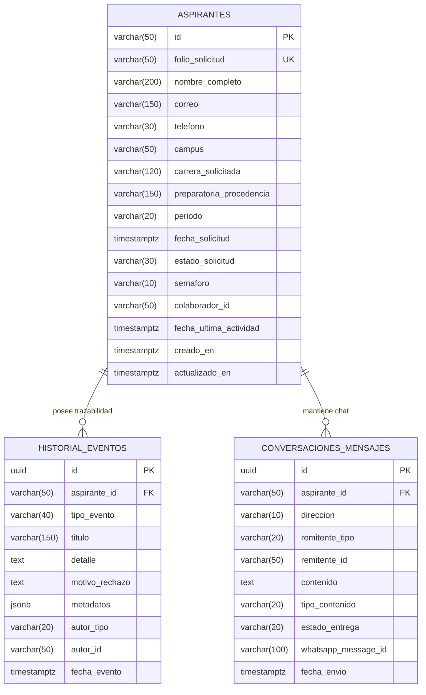

# Modelo de Datos del Esquema Aspirantes: Historial y Conversaciones

**Tarea:** EQ-41 · HU3-2 (Sprint 1)  
**Historia de Usuario Asociada:** HU 3 (Expediente y trazabilidad del aspirante)  
**Responsable:** Sebastián Bórquez Huerta  
**Estado:** Implementado y Verificado  

---

## 1. Propósito y Alcance

El objetivo de la tarea **HU3-2** es diseñar e implementar las tablas del esquema `aspirantes` en PostgreSQL para dar soporte al expediente único del aspirante, a la línea de tiempo de trazabilidad (mensajes enviados, constancias entregadas y motivos de rechazo) y a las conversaciones de chat bidireccionales vía WhatsApp, optimizando el acceso mediante índices compuestos por aspirante y fecha.

---

## 2. Diagrama Entidad-Relación (ER)



---

## 3. Diccionario de Datos

### 3.1 Tabla `aspirantes.aspirantes`
| Columna | Tipo | Nulo | Descripción / Reglas |
|---|---|---|---|
| `id` | VARCHAR(50) | NO | Identificador único del aspirante (PK, ej. `asp-001`). |
| `folio_solicitud` | VARCHAR(50) | NO | Folio único institucional emitido por Registro Escolar. |
| `nombre_completo` | VARCHAR(200) | NO | Nombre y apellidos del aspirante. |
| `correo` | VARCHAR(150) | NO | Correo electrónico de contacto. |
| `telefono` | VARCHAR(30) | NO | Teléfono móvil normalizado con prefijo internacional para WhatsApp (`+52...`). |
| `campus` | VARCHAR(50) | NO | Campus ITSON (Obregón Náinari, Obregón Centro, Navojoa, Guaymas, Empalme). |
| `carrera_solicitada`| VARCHAR(120) | NO | Programa educativo elegido. |
| `preparatoria_procedencia` | VARCHAR(150) | NO | Escuela de origen (CBTIS 37, COBACH Obregón 1, CECyTE, etc.). |
| `periodo` | VARCHAR(20) | NO | Período académico (ej. `2027-1`). |
| `fecha_solicitud` | TIMESTAMPTZ | NO | Fecha y hora en que se postuló. |
| `estado_solicitud` | VARCHAR(30) | NO | Estado reportado por Registro Escolar: `RECIBIDA`, `EN_REVISION`, `ACEPTADA`, `RECHAZADA`. |
| `semaforo` | VARCHAR(10) | NO | Semáforo operativo de inactividad: `VERDE`, `AMARILLO`, `ROJO`. |
| `colaborador_id` | VARCHAR(50) | SÍ | ID del colaborador responsable de la cartera. Reasignable en HU 6. |
| `fecha_ultima_actividad` | TIMESTAMPTZ | NO | Timestamp del último evento o mensaje para calcular el semáforo. |

### 3.2 Tabla `aspirantes.historial_eventos`
| Columna | Tipo | Nulo | Descripción / Reglas |
|---|---|---|---|
| `id` | UUID | NO | Identificador del evento (PK, generado automáticamente). |
| `aspirante_id` | VARCHAR(50) | NO | FK hacia `aspirantes.aspirantes(id)` con `ON DELETE CASCADE`. |
| `tipo_evento` | VARCHAR(40) | NO | `MENSAJE_ENVIADO`, `CONSTANCIA_ENTREGADA`, `CAMBIO_ESTADO`, `RECHAZO_SOLICITUD`, `NOTA_SEGUIMIENTO`. |
| `titulo` | VARCHAR(150) | NO | Título descriptivo para la cabecera de la línea de tiempo. |
| `detalle` | TEXT | SÍ | Descripción ampliada del evento o contenido del comunicado. |
| `motivo_rechazo` | TEXT | SÍ | Motivo escolar específico cuando `tipo_evento = 'RECHAZO_SOLICITUD'`. |
| `metadatos` | JSONB | SÍ | Atributos adicionales en formato JSON estructurado. |
| `autor_tipo` | VARCHAR(20) | NO | Origen del evento: `SISTEMA`, `IA`, `COLABORADOR`, `REGISTRO_ESCOLAR`. |
| `autor_id` | VARCHAR(50) | SÍ | Identificador del actor si fue un colaborador humano. |
| `fecha_evento` | TIMESTAMPTZ | NO | Momento exacto del suceso. |

### 3.3 Tabla `aspirantes.conversaciones_mensajes`
| Columna | Tipo | Nulo | Descripción / Reglas |
|---|---|---|---|
| `id` | UUID | NO | Identificador del mensaje (PK). |
| `aspirante_id` | VARCHAR(50) | NO | FK hacia `aspirantes.aspirantes(id)` con `ON DELETE CASCADE`. |
| `direccion` | VARCHAR(10) | NO | `ENTRANTE` (desde el aspirante) o `SALIENTE` (hacia el aspirante). |
| `remitente_tipo` | VARCHAR(20) | NO | `ASPIRANTE`, `BOT_IA`, `COLABORADOR`, `SISTEMA`. |
| `remitente_id` | VARCHAR(50) | SÍ | ID del remitente o número de teléfono. |
| `contenido` | TEXT | NO | Cuerpo del mensaje de texto. |
| `tipo_contenido` | VARCHAR(20) | NO | `TEXTO`, `IMAGEN`, `DOCUMENTO`, `AUDIO`. |
| `estado_entrega` | VARCHAR(20) | NO | `PENDIENTE`, `ENVIADO`, `ENTREGADO`, `LEIDO`, `FALLIDO`. |
| `whatsapp_message_id` | VARCHAR(100) | SÍ | Identificador externo wamid emitido por Meta WhatsApp API. |
| `fecha_envio` | TIMESTAMPTZ | NO | Fecha y hora de envío o recepción. |

---

## 4. Estrategia de Índices Compuestos

Para garantizar alto rendimiento bajo volumen y responder a los criterios de aceptación de HU 3 y HU 2:

1. **`idx_historial_aspirante_fecha` sobre `(aspirante_id, fecha_evento DESC)`:**
   - **Propósito:** Optimiza el endpoint `HU3-4` (*Línea de tiempo unificada del más reciente al más antiguo*).
   - **Beneficio:** Evita escaneos secuenciales (*Seq Scan*) y operaciones costosas de ordenamiento en memoria (*Sort*), utilizando un escaneo indexado directo (*Index Scan*).
2. **`idx_conversacion_aspirante_fecha` sobre `(aspirante_id, fecha_envio ASC)`:**
   - **Propósito:** Optimiza el endpoint `HU3-5` (*Carga de conversación de mensajería en orden cronológico natural*).
3. **`idx_conversacion_aspirante_fecha_desc` sobre `(aspirante_id, fecha_envio DESC)`:**
   - **Propósito:** Permite paginación infinita hacia atrás (*infinite scrolling*) en la interfaz de chat, trayendo los últimos $N$ mensajes instantáneamente.
4. **`idx_aspirantes_colaborador` sobre `(colaborador_id)`:**
   - **Propósito:** Optimiza la consulta principal de la tabla de seguimiento de `HU 2` (*solo aspirantes asignados al asesor autenticado*).

---

## 5. Integridad en Reasignaciones de Cartera (HU6-4)

> [!IMPORTANT]
> Siguiendo el requerimiento de arquitectura **HU6-4**:
> Todas las tablas hijas (`historial_eventos` y `conversaciones_mensajes`) están asociadas estrictamente a la llave `aspirante_id`. 
> Cuando un administrador reasigna un aspirante de un colaborador a otro en HU 6 (`UPDATE aspirantes SET colaborador_id = 'nuevo-colaborador' WHERE id = 'asp-001'`), **la totalidad del expediente, la línea de tiempo y el historial de chat viajan automáticamente con el alumno sin requerir migraciones ni duplicidad de registros**.

---

## 6. Consultas SQL Modelo para Endpoints de HU 3

### 6.1 Detalle del Expediente (HU3-3)
```sql
SELECT 
    id, folio_solicitud, nombre_completo, correo, telefono,
    campus, carrera_solicitada, preparatoria_procedencia, periodo,
    fecha_solicitud, estado_solicitud, semaforo, colaborador_id,
    fecha_ultima_actividad
FROM aspirantes.aspirantes
WHERE id = $1 AND colaborador_id = $2;
```

### 6.2 Línea de Tiempo Unificada con Paginación (HU3-4)
```sql
SELECT 
    id, tipo_evento, titulo, detalle, motivo_rechazo, metadatos, autor_tipo, fecha_evento
FROM aspirantes.historial_eventos
WHERE aspirante_id = $1
ORDER BY fecha_evento DESC
LIMIT $2 OFFSET $3;
```

### 6.3 Conversación de Chat para Mensajería (HU3-5)
```sql
SELECT 
    id, direccion, remitente_tipo, remitente_id, contenido,
    tipo_contenido, estado_entrega, fecha_envio
FROM aspirantes.conversaciones_mensajes
WHERE aspirante_id = $1
ORDER BY fecha_envio ASC;
```
