# Modelo de Datos Consolidado — PostgreSQL 16 (SIRA)

**Tarea:** EQ-24 · `[QA-5]`  
**Motor:** PostgreSQL 16 (`postgres:16-alpine`)  
**Extensiones requeridas:** `uuid-ossp`, `pgcrypto` (definidas en [init-schemas.sql](file:///c:/Users/sonic/OneDrive/Documentos/GitHub/SIRA/docker/postgres/init-schemas.sql))

---

## 1. Principios Arquitectónicos del Modelo de Datos

1. **Aislamiento por esquemas de negocio ([propiedad-esquemas.md](file:///c:/Users/sonic/OneDrive/Documentos/GitHub/SIRA/docs/arquitectura/propiedad-esquemas.md)):**
   - Cada módulo de negocio es propietario exclusivo de las escrituras (`INSERT`, `UPDATE`, `DELETE`) sobre su esquema en PostgreSQL.
   - Ningún módulo externo ejecuta consultas SQL directas contra las tablas de otro módulo; toda interacción ocurre a través de puertos/interfaces públicas en memoria (p. ej. `moduloMonitoreo.cartera` o `moduloMensajes.interfazLectura`) o eventos en el bus (`crm.eventos`).
2. **Prohibición de llaves foráneas entre esquemas (`BASE-5`):**
   - Las llaves foráneas (`REFERENCES`) solo existen **dentro del mismo esquema** (por ejemplo, `aspirantes.historial_eventos.aspirante_id -> aspirantes.aspirantes.id` o `disparo.envio.lote_id -> disparo.lote.id`).
   - Las referencias entre módulos distintos (como `aspirantes.aspirantes.colaborador_id`, `usuarios.bitacora_transferencia.aspirante_id` o `disparo.envio.aspirante_id`) se almacenan como identificadores lógicos (`VARCHAR(50)`) sin `FOREIGN KEY` cruzada. La consistencia entre esquemas se coordina en la capa de aplicación mediante transacciones con compensación saga (`deshacer()`).
3. **Cero almacenamiento de contraseñas institucionales:**
   - El esquema `usuarios` solo guarda atributos propios del CRM (`id_directorio`, `rol`, `estado`, `campus_id`, `casos_especiales`, `baja_desde`, `baja_hasta`). La autenticación y los datos personales (`nombreCompleto`, `correoInstitucional`, `telefono`, `fotoUrl`) provienen del directorio institucional (`IProveedorAutenticacion`, `BASE-7`).

---

## 2. Mapa General de Esquemas

| Esquema | Módulo Propietario | Estado en Sprint 2 | Scripts SQL / Migraciones |
|---|---|---|---|
| `usuarios` | `src/modulos/colaboradores/` | **Activo** | `init-schemas.sql`, `Tablas.sql` (`EQ-53`), [06_casos_especiales_transferencias.sql](file:///c:/Users/sonic/OneDrive/Documentos/GitHub/SIRA/docker/postgres/migrations/06_casos_especiales_transferencias.sql), [10_baja_colaboradores.sql](file:///c:/Users/sonic/OneDrive/Documentos/GitHub/SIRA/docker/postgres/migrations/10_baja_colaboradores.sql) |
| `aspirantes` | `src/modulos/monitoreo/` | **Activo** | [01_esquema_aspirantes.sql](file:///c:/Users/sonic/OneDrive/Documentos/GitHub/SIRA/docker/postgres/migrations/01_esquema_aspirantes.sql), [02_ajuste_llaves_historial.sql](file:///c:/Users/sonic/OneDrive/Documentos/GitHub/SIRA/docker/postgres/migrations/02_ajuste_llaves_historial.sql), [09_resultados_envio.sql](file:///c:/Users/sonic/OneDrive/Documentos/GitHub/SIRA/docker/postgres/migrations/09_resultados_envio.sql), [02_aspirantes_semilla.sql](file:///c:/Users/sonic/OneDrive/Documentos/GitHub/SIRA/datos-semilla/02_aspirantes_semilla.sql) |
| `mensajes` | `src/modulos/mensajes/` y `src/modulos/mensajes-ia/` | **Activo** | [03_esquema_mensajes_configuracion.sql](file:///c:/Users/sonic/OneDrive/Documentos/GitHub/SIRA/docker/postgres/migrations/03_esquema_mensajes_configuracion.sql), [04_bitacora_configuracion_mensajes.sql](file:///c:/Users/sonic/OneDrive/Documentos/GitHub/SIRA/docker/postgres/migrations/04_bitacora_configuracion_mensajes.sql), [05_catalogo_mensajes.sql](file:///c:/Users/sonic/OneDrive/Documentos/GitHub/SIRA/docker/postgres/migrations/05_catalogo_mensajes.sql), [05_catalogo_mensajes_semilla.sql](file:///c:/Users/sonic/OneDrive/Documentos/GitHub/SIRA/datos-semilla/05_catalogo_mensajes_semilla.sql) |
| `disparo` | `src/modulos/disparo-automatico/` | **Activo** | [07_lotes_envio.sql](file:///c:/Users/sonic/OneDrive/Documentos/GitHub/SIRA/docker/postgres/migrations/07_lotes_envio.sql), [08_envio_parametros.sql](file:///c:/Users/sonic/OneDrive/Documentos/GitHub/SIRA/docker/postgres/migrations/08_envio_parametros.sql), [09_resultados_envio.sql](file:///c:/Users/sonic/OneDrive/Documentos/GitHub/SIRA/docker/postgres/migrations/09_resultados_envio.sql) |
| `alertas` | Módulo futuro (Alertas) | **Reservado** (creado vacío en `init-schemas.sql`) | [init-schemas.sql](file:///c:/Users/sonic/OneDrive/Documentos/GitHub/SIRA/docker/postgres/init-schemas.sql) |
| `conocimiento` | Módulo futuro (Conocimiento / FAQs IA) | **Reservado** (creado vacío en `init-schemas.sql`) | [init-schemas.sql](file:///c:/Users/sonic/OneDrive/Documentos/GitHub/SIRA/docker/postgres/init-schemas.sql) |

---

## 3. Diagrama Entidad-Relación Consolidado

```mermaid
erDiagram
    %% Esquema: usuarios
    USUARIOS_USUARIO {
        uuid id PK
        varchar id_directorio UK "ID institucional (5..20 dígitos)"
        enum rol "colaborador | administrador"
        enum estado "borrador | activo | inactivo"
        smallint campus_id "Traducido vía catalogoIds"
        boolean casos_especiales "Migración 06 (DEFAULT FALSE)"
        date baja_desde "Migración 10 (NULL si activo)"
        date baja_hasta "Migración 10 (NULL si indefinida)"
        timestamptz created_at
        timestamptz updated_at
    }
    USUARIOS_COLABORADOR_CARRERA {
        uuid usuario_id PK, FK
        smallint carrera_id PK "Traducido vía catalogoIds"
    }
    USUARIOS_BITACORA_TRANSFERENCIA {
        uuid id PK
        varchar aspirante_id "Ref. lógica a aspirantes.aspirantes.id"
        uuid colaborador_origen FK "NULL si no tenía responsable"
        uuid colaborador_destino FK
        enum motivo "alta | inactivacion | manual"
        uuid realizado_por FK
        timestamptz created_at
    }

    USUARIOS_USUARIO ||--o{ USUARIOS_COLABORADOR_CARRERA : "atiende"
    USUARIOS_USUARIO ||--o{ USUARIOS_BITACORA_TRANSFERENCIA : "origen / destino / autor"

    %% Esquema: aspirantes
    ASPIRANTES_ASPIRANTES {
        varchar id PK "Ej. asp-001"
        varchar folio_solicitud UK
        varchar nombre_completo
        varchar correo
        varchar telefono
        varchar campus
        varchar carrera_solicitada
        varchar preparatoria_procedencia
        varchar periodo
        timestamptz fecha_solicitud
        varchar estado_solicitud "RECIBIDA | EN_REVISION | ACEPTADA | RECHAZADA"
        varchar semaforo "VERDE | AMARILLO | ROJO"
        varchar colaborador_id "Ref. lógica a usuarios.usuario.id_directorio"
        timestamptz fecha_ultima_actividad "Actividad académica/entrante"
        timestamptz fecha_ultima_notificacion "Migración 09: último envío saliente HU1"
        integer veces_notificado "Migración 09: conteo de lotes HU1 (>= 0)"
        timestamptz creado_en
        timestamptz actualizado_en
    }
    ASPIRANTES_HISTORIAL_EVENTOS {
        uuid id PK
        varchar aspirante_id FK "ON DELETE CASCADE"
        varchar tipo_evento "MENSAJE_ENVIADO | CONSTANCIA_ENTREGADA | CAMBIO_ESTADO | RECHAZO_SOLICITUD | NOTA_SEGUIMIENTO | MENSAJE_AUTOMATICO"
        varchar titulo
        text detalle
        text motivo_rechazo
        jsonb metadatos
        varchar autor_tipo "SISTEMA | IA | COLABORADOR | REGISTRO_ESCOLAR"
        varchar autor_id
        timestamptz fecha_evento
    }
    ASPIRANTES_CONVERSACIONES_MENSAJES {
        uuid id PK
        varchar aspirante_id FK "ON DELETE CASCADE"
        varchar direccion "ENTRANTE | SALIENTE"
        varchar remitente_tipo "ASPIRANTE | BOT_IA | COLABORADOR | SISTEMA"
        varchar remitente_id
        text contenido
        varchar tipo_contenido "TEXTO | IMAGEN | DOCUMENTO | AUDIO"
        varchar estado_entrega "PENDIENTE | ENVIADO | ENTREGADO | LEIDO | FALLIDO"
        varchar whatsapp_message_id
        timestamptz fecha_envio
    }

    ASPIRANTES_ASPIRANTES ||--o{ ASPIRANTES_HISTORIAL_EVENTOS : "trazabilidad (HU6-4)"
    ASPIRANTES_ASPIRANTES ||--o{ ASPIRANTES_CONVERSACIONES_MENSAJES : "conversación (HU6-4)"

    %% Esquema: mensajes
    MENSAJES_CONFIGURACION_PARAMETROS {
        smallint id PK "CHECK (id = 1)"
        varchar zona_horaria "America/Hermosillo"
        integer espera_respuesta_valor "1..720 h equiv."
        varchar espera_respuesta_unidad "horas | dias"
        integer espera_contacto_previo_valor "1..720 h equiv."
        varchar espera_contacto_previo_unidad "horas | dias"
        timestamptz actualizado_en
        varchar actualizado_por
    }
    MENSAJES_CONFIGURACION_JORNADA {
        varchar dia_semana PK "lunes..domingo"
        smallint orden_dia UK "1..7"
        boolean habilitado
        varchar hora_inicio "HH:MM o NULL"
        varchar hora_fin "HH:MM o NULL (hora_inicio < hora_fin)"
    }
    MENSAJES_CONFIGURACION_BITACORA {
        uuid id PK
        varchar usuario_id
        timestamptz fecha_cambio
        jsonb valor_anterior
        jsonb valor_nuevo
    }
    MENSAJES_CATALOGO_MENSAJE {
        varchar id PK
        varchar categoria "ENVIO | RESPUESTA"
        varchar nombre
        smallint orden
        varchar grupo
        varchar pregunta
        varchar disparador "AUTOMATICO | MANUAL | AUTOMATICO_Y_MANUAL | LOTE_HU1 | RESPUESTA"
        varchar canal
        boolean requiere_plantilla_meta
        varchar plantilla_meta_referencia
        varchar plantilla_meta_estado
        text texto
        boolean activo
        varchar fuente
    }
    MENSAJES_CATALOGO_VARIABLE {
        varchar mensaje_id PK, FK
        varchar nombre PK "aspirante | carrera | valor | magnitud"
        smallint orden
    }
    MENSAJES_CATALOGO_LLAVE {
        varchar mensaje_id PK, FK
        smallint orden PK
        varchar tipo
        varchar valor
    }
    MENSAJES_CATALOGO_REGLA {
        varchar mensaje_id PK, FK
        smallint orden PK
        text descripcion
    }

    MENSAJES_CATALOGO_MENSAJE ||--o{ MENSAJES_CATALOGO_VARIABLE : "variables"
    MENSAJES_CATALOGO_MENSAJE ||--o{ MENSAJES_CATALOGO_LLAVE : "llaves"
    MENSAJES_CATALOGO_MENSAJE ||--o{ MENSAJES_CATALOGO_REGLA : "reglas"

    %% Esquema: disparo
    DISPARO_LOTE {
        uuid id PK
        varchar colaborador_id
        varchar clave_idempotencia
        char huella
        jsonb filtros
        boolean enviar_por_correo
        varchar estado "CREADO"
        integer total_aspirantes
        integer total_envios_pendientes
        timestamptz creado_en
    }
    DISPARO_ENVIO {
        uuid id PK
        uuid lote_id FK "ON DELETE CASCADE"
        varchar aspirante_id "Ref. lógica a aspirantes.aspirantes.id"
        varchar canal "WHATSAPP | CORREO"
        varchar estado "PENDIENTE | NO_ENVIABLE"
        varchar mensaje_id
        varchar destino
        text texto
        text[] parametros "Migración 08"
        text motivo
        varchar codigo_motivo
        text[] faltantes
        timestamptz publicado_en
        timestamptz reclamado_hasta
        varchar resultado "Migración 09: ENVIADO | FALLIDO | DIFERIDO"
        varchar resultado_codigo
        text resultado_motivo
        varchar whatsapp_message_id
        integer intentos
        timestamptz resultado_en
    }

    DISPARO_LOTE ||--o{ DISPARO_ENVIO : "contiene"
```

---

## 4. Detalle por Esquema y Tablas

### 4.1. Esquema `usuarios` (Módulo `Colaboradores` · HU 6 y HU 7)

Consultado y modificado exclusivamente por [repositorio-colaboradores-postgres.js](file:///c:/Users/sonic/OneDrive/Documentos/GitHub/SIRA/src/modulos/colaboradores/infraestructura/repositorio-colaboradores-postgres.js).

1. **`usuarios.usuario`** (`EQ-53` + migraciones `06` y `10`):
   - `id` (`UUID PRIMARY KEY DEFAULT gen_random_uuid()`): identificador interno en base de datos.
   - `id_directorio` (`VARCHAR(20) UNIQUE NOT NULL`): ID institucional del colaborador o administrador (`00000252115`).
   - `rol` (`usuarios.rol NOT NULL`): `'colaborador'` o `'administrador'`.
   - `estado` (`usuarios.estado_usuario NOT NULL`): `'borrador'`, `'activo'` o `'inactivo'`.
   - `campus_id` (`SMALLINT NULL`): identificador numérico del campus traducido por `catalogoIds` para evitar FKs con otros esquemas.
   - `casos_especiales` (`BOOLEAN NOT NULL DEFAULT FALSE`, migración `06`): autoriza al colaborador a recibir expedientes transferidos manualmente desde otros campus (`HU6-11 / EQ-70`).
   - `baja_desde` (`DATE NULL`, migración `10`): fecha de inicio de la baja del colaborador (`HU6-18`).
   - `baja_hasta` (`DATE NULL`, migración `10`): fecha de fin de la baja (`NULL` cuando la baja es indefinida).
   - `created_at`, `updated_at` (`TIMESTAMPTZ NOT NULL DEFAULT now()`).
2. **`usuarios.colaborador_carrera`** (`EQ-53`):
   - `usuario_id` (`UUID NOT NULL REFERENCES usuarios.usuario(id) ON DELETE CASCADE`).
   - `carrera_id` (`SMALLINT NOT NULL`): identificador numérico de la carrera traducido por `catalogoIds`.
   - `PRIMARY KEY (usuario_id, carrera_id)`.
3. **`usuarios.bitacora_transferencia`** (`EQ-53`, `EQ-59`, `EQ-69`, `EQ-70`):
   - `aspirante_id` (`VARCHAR(50) NOT NULL`): referencia lógica al expediente en `aspirantes.aspirantes.id` (ver nota en [colaboradores.md](file:///c:/Users/sonic/OneDrive/Documentos/GitHub/SIRA/docs/contratos/colaboradores.md#L227-L240)).
   - `colaborador_origen` (`UUID NULL REFERENCES usuarios.usuario(id)`): responsable previo (`NULL` si el aspirante no tenía colaborador asignado).
   - `colaborador_destino` (`UUID NOT NULL REFERENCES usuarios.usuario(id)`): nuevo responsable.
   - `motivo` (`usuarios.motivo_transferencia NOT NULL`): `'alta'`, `'inactivacion'` o `'manual'`.
   - `realizado_por` (`UUID NOT NULL REFERENCES usuarios.usuario(id)`): administrador que ejecutó la operación.

---

### 4.2. Esquema `aspirantes` (Módulo `Monitoreo` · HU 2, HU 3, HU 4 y HU 1)

Consultado y modificado exclusivamente por [repositorio-monitoreo-postgres.js](file:///c:/Users/sonic/OneDrive/Documentos/GitHub/SIRA/src/modulos/monitoreo/infraestructura/repositorio-monitoreo-postgres.js). Documentación base previa en [esquema-aspirantes-hu3.md](file:///c:/Users/sonic/OneDrive/Documentos/GitHub/SIRA/docs/modelado/esquema-aspirantes-hu3.md).

1. **`aspirantes.aspirantes`** (migraciones `01` y `09`):
   - **Clave primaria:** `id VARCHAR(50)` (`'asp-001'`), más `folio_solicitud VARCHAR(50) UNIQUE NOT NULL`.
   - **Cartera:** `colaborador_id VARCHAR(50) NULL` (ID institucional del colaborador responsable).
   - **Separación estricta entre actividad del aspirante y notificación saliente (migración `09` · `EQ-87`):**
     - `fecha_ultima_actividad TIMESTAMPTZ NOT NULL`: refleja la actividad del aspirante o cambios académicos; determina el cálculo de inactividad y del semáforo.
     - `fecha_ultima_notificacion TIMESTAMPTZ NULL`: registra el último mensaje automático saliente enviado con éxito en un lote de HU 1; se utiliza para calcular la ventana de exclusión por contacto previo (`tiempoEsperaContactoPrevio` de HU 9, por defecto `48 h`) **sin alterar** `fecha_ultima_actividad`.
     - `veces_notificado INTEGER NOT NULL DEFAULT 0 CHECK (veces_notificado >= 0)`: número de lotes de HU 1 en los que el aspirante ha sido notificado.
   - **Índices:** `idx_aspirantes_colaborador (colaborador_id)`, `idx_aspirantes_semaforo (semaforo)`, `idx_aspirantes_estado (estado_solicitud)`, `idx_aspirantes_campus_carrera (campus, carrera_solicitada)`.
2. **`aspirantes.historial_eventos`** (migraciones `01`, `02` y `09`):
   - `id UUID PRIMARY KEY DEFAULT gen_random_uuid()`.
   - `aspirante_id VARCHAR(50) NOT NULL REFERENCES aspirantes.aspirantes(id) ON DELETE CASCADE ON UPDATE CASCADE`.
   - `tipo_evento VARCHAR(40) NOT NULL`: restricción `ck_historial_tipo_evento` actualizada en la migración `09` para admitir `'MENSAJE_ENVIADO'`, `'CONSTANCIA_ENTREGADA'`, `'CAMBIO_ESTADO'`, `'RECHAZO_SOLICITUD'`, `'NOTA_SEGUIMIENTO'` y `'MENSAJE_AUTOMATICO'`.
   - `metadatos JSONB NULL DEFAULT '{}'::jsonb`: en eventos `MENSAJE_AUTOMATICO` almacena `{ loteId, envioId, canal, resultado, codigo, whatsappMessageId }`.
   - **Índice:** `idx_historial_aspirante_fecha ON aspirantes.historial_eventos (aspirante_id, fecha_evento DESC)`.
3. **`aspirantes.conversaciones_mensajes`** (migraciones `01` y `02`):
   - `id UUID PRIMARY KEY DEFAULT gen_random_uuid()`.
   - `aspirante_id VARCHAR(50) NOT NULL REFERENCES aspirantes.aspirantes(id) ON DELETE CASCADE ON UPDATE CASCADE`.
   - `direccion` (`'ENTRANTE' | 'SALIENTE'`), `remitente_tipo` (`'ASPIRANTE' | 'BOT_IA' | 'COLABORADOR' | 'SISTEMA'`), `estado_entrega` (`'PENDIENTE' | 'ENVIADO' | 'ENTREGADO' | 'LEIDO' | 'FALLIDO'`), `whatsapp_message_id VARCHAR(100) NULL`.
   - **Índices:** `idx_conversacion_aspirante_fecha (aspirante_id, fecha_envio ASC)` e `idx_conversacion_aspirante_fecha_desc (aspirante_id, fecha_envio DESC)`.
4. **Garantía `HU6-4` (migración `02_ajuste_llaves_historial.sql`):**
   - Asegura y audita mediante un bloque `DO $$ ... $$` que `historial_eventos`, `conversaciones_mensajes` y las tablas auxiliares (`mensajes`, `constancias`, `rechazos`, `conversacion_chat`) no tengan ninguna columna ni FK `colaborador_id` y dependan únicamente de `aspirantes.aspirantes(id)` con `ON DELETE CASCADE ON UPDATE CASCADE`. Así, cuando un colaborador es dado de baja o se transfiere un expediente manualmente, basta con actualizar `aspirantes.aspirantes.colaborador_id` para que todo el historial y la conversación viajen intactos con el aspirante.

---

### 4.3. Esquema `mensajes` (Módulos `Mensajes` HU 9 y `Mensajes-IA` HU 8)

1. **`mensajes.configuracion_parametros`** (migración `03` · `EQ-104`):
   - Tabla de fila única garantizada por `id SMALLINT PRIMARY KEY DEFAULT 1 CHECK (id = 1)`.
   - `zona_horaria VARCHAR(60) NOT NULL DEFAULT 'America/Hermosillo' CHECK (zona_horaria = 'America/Hermosillo')`.
   - `espera_respuesta_valor` + `espera_respuesta_unidad` (`'horas' | 'dias'`) y `espera_contacto_previo_valor` + `espera_contacto_previo_unidad` (`'horas' | 'dias'`), ambos validados por las restricciones `chk_espera_respuesta_rango_horas` y `chk_espera_contacto_previo_rango_horas` para que su equivalencia en horas esté entre `1` y `720` (`1 hora` a `30 días`).
   - Semilla inicial del PO: `24 horas` de espera de respuesta y `48 horas` de espera de contacto previo.
2. **`mensajes.configuracion_jornada`** (migración `03` · `EQ-104`):
   - `dia_semana VARCHAR(15) PRIMARY KEY` (`'lunes'` a `'domingo'`), `orden_dia SMALLINT NOT NULL UNIQUE CHECK (orden_dia BETWEEN 1 AND 7)`.
   - Restricción `chk_jornada_horario_valido`: si `habilitado = TRUE`, exige `hora_inicio` y `hora_fin` en formato `HH:MM` (`00:00..23:59`) con `hora_inicio < hora_fin`; si `habilitado = FALSE`, exige que ambos sean `NULL`.
   - Semilla inicial del PO: lunes a viernes habilitados `08:00` a `18:00`, sábado y domingo deshabilitados (`NULL`).
3. **`mensajes.configuracion_bitacora`** (migración `04` · `EQ-108`):
   - `id UUID PRIMARY KEY DEFAULT gen_random_uuid()`, `usuario_id VARCHAR(50) NOT NULL`, `fecha_cambio TIMESTAMPTZ NOT NULL DEFAULT CURRENT_TIMESTAMP`, `valor_anterior JSONB NOT NULL`, `valor_nuevo JSONB NOT NULL`.
   - Se inserta dentro de la misma transacción `BEGIN ... COMMIT` que actualiza `configuracion_parametros` y `configuracion_jornada` en [repositorio-configuracion-postgres.js](file:///c:/Users/sonic/OneDrive/Documentos/GitHub/SIRA/src/modulos/mensajes/infraestructura/repositorio-configuracion-postgres.js).
   - **Índices:** `idx_configuracion_bitacora_fecha (fecha_cambio DESC)` e `idx_configuracion_bitacora_usuario (usuario_id)`.
4. **Catálogo de mensajes predefinidos de solo lectura** (migración `05` · `EQ-95` + semilla `05_catalogo_mensajes_semilla.sql`):
   - `mensajes.catalogo_mensaje`: almacena los 15 mensajes aprobados en `EQ-93` (`categoria IN ('ENVIO', 'RESPUESTA')`, `disparador`, `requiere_plantilla_meta`, `plantilla_meta_referencia`, `plantilla_meta_estado`, `texto`, `uq_catalogo_orden_por_categoria`).
   - Tablas hijas con `ON DELETE CASCADE`: `mensajes.catalogo_variable`, `mensajes.catalogo_llave` y `mensajes.catalogo_regla`.
   - **Índice parcial:** `idx_catalogo_mensaje_categoria_orden ON mensajes.catalogo_mensaje (categoria, orden) WHERE activo`.

---

### 4.4. Esquema `disparo` (Módulo `Disparo Automático` · HU 1)

Consultado y modificado exclusivamente por [repositorio-lotes-postgres.js](file:///c:/Users/sonic/OneDrive/Documentos/GitHub/SIRA/src/modulos/disparo-automatico/infraestructura/repositorio-lotes-postgres.js).

1. **`disparo.lote`** (migración `07` · `EQ-83`):
   - `id UUID PRIMARY KEY`, `colaborador_id VARCHAR(50) NOT NULL`, `clave_idempotencia VARCHAR(100) NULL`, `huella CHAR(64) NOT NULL` (SHA-256 de los filtros y destinatarios), `filtros JSONB NOT NULL`, `enviar_por_correo BOOLEAN NOT NULL DEFAULT FALSE`, `estado VARCHAR(20) NOT NULL DEFAULT 'CREADO'`, `total_aspirantes INTEGER NOT NULL CHECK (total_aspirantes > 0)`, `total_envios_pendientes INTEGER NOT NULL CHECK (total_envios_pendientes >= 0)`, `creado_en TIMESTAMPTZ NOT NULL DEFAULT now()`.
   - **Idempotencia:** `CONSTRAINT uq_lote_clave_idempotencia UNIQUE (colaborador_id, clave_idempotencia)` e índice `ix_lote_huella (colaborador_id, huella, creado_en DESC)`.
2. **`disparo.envio`** (migraciones `07`, `08` y `09`):
   - `id UUID PRIMARY KEY`, `lote_id UUID NOT NULL REFERENCES disparo.lote(id) ON DELETE CASCADE`, `aspirante_id VARCHAR(50) NOT NULL`, `canal VARCHAR(10) NOT NULL CHECK (canal IN ('WHATSAPP', 'CORREO'))`, `estado VARCHAR(12) NOT NULL CHECK (estado IN ('PENDIENTE', 'NO_ENVIABLE'))`.
   - `parametros TEXT[] NOT NULL DEFAULT '{}'` (migración `08` · `EQ-85`): parámetros posicionales `{{1}}`, `{{2}}` para la plantilla de WhatsApp Cloud API.
   - Columnas de resultado (migración `09` · `EQ-87`): `resultado VARCHAR(10) NULL` (`'ENVIADO' | 'FALLIDO' | 'DIFERIDO'`), `resultado_codigo VARCHAR(60) NULL`, `resultado_motivo TEXT NULL`, `whatsapp_message_id VARCHAR(200) NULL`, `intentos INTEGER NULL`, `resultado_en TIMESTAMPTZ NULL`.
   - **Restricciones e índices:** `uq_envio_aspirante_canal UNIQUE (lote_id, aspirante_id, canal)`, `ck_envio_estado`, `ck_envio_resultado` e índice parcial `ix_envio_sin_publicar (lote_id) WHERE estado = 'PENDIENTE' AND publicado_en IS NULL`.
